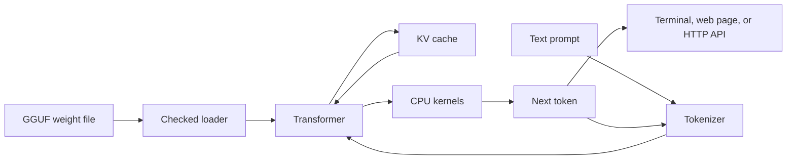

# Neuron

[](https://github.com/DanielMellen-University/Neuron/actions/workflows/ci.yml)


[](LICENSE)

**A from-scratch C++ inference engine that runs small language models on a laptop CPU, with no inference library underneath.**

Neuron reads GGUF files (the usual format for local Llama-style models), runs the transformer itself, and generates text. You can chat in the terminal, open a local web page, or talk to it with the official OpenAI Python client. llama.cpp is an external reference used for checks and quantization, not a library the engine links against.

The interesting part is that the whole path is in this repo: the file loader, the tokenizer, attention, the packed weight formats, and the CPU kernels. It also remains substantially slower than llama.cpp on the target Qwen model. R1 reaches 55.02% of llama.cpp's generation rate in the short Q4_K_M benchmark. The numbers below are the measured ones, including the targets that were missed.


Recorded from `neuron chat` on an Intel Core i5-1135G7 laptop (4 cores/8 threads, AVX-512 VNNI) at real time, including model load and prompt evaluation. The full [timed transcript](bench/reference/m7-demo.json) and [recording method](docs/demo.md) are committed. The demo uses a short reply limit; the quick start uses the normal defaults.

## Features

- **Checked GGUF loading** for dense Llama and Qwen2 models, plus `neuron inspect` to list a file's metadata and tensors, including F32, F16, and the packed Q8_0, Q4_0, Q4_K and Q6_K weight formats. F16 weights are converted to FP32 when loaded. Packed matrices stay mapped and are decoded during use.
- **A complete forward pass**: RMSNorm, rotary position embeddings, grouped-query attention, QKV bias where needed, SwiGLU, and a per-layer FP32 KV cache (the stored keys and values from earlier tokens in the same reply).
- **Tokenizers in C++**: Llama score-based merges and Qwen2/SmolLM2 byte BPE, including Unicode pre-tokenization and special tokens.
- **CPU kernels** for scalar, AVX2, AVX-512 and VNNI, with runtime CPU/OS checks and a thread pool that splits work by output row. One default build contains every variant. `--isa auto` selects AVX-512, then AVX2, then scalar.
- **Terminal chat** with streaming replies, optional sampling and stop strings, history, `/reset`, `/exit`, and Ctrl-C to stop the current reply without killing the session.
- **A local web page and OpenAI-compatible API** from `neuron serve`, with no frontend build and no CDN. The official Python client works against it.
- **Greedy decoding or seeded sampling** (temperature, top-k, top-p, min-p and a repeat penalty), JSON token/timing output, logit export, reference checks and chunked perplexity evaluation. See the [command-line reference](docs/cli.md).

## Quick start

Use x86-64 Linux, CMake, Python and GCC or Clang with C++20 support. The [checked toolchain](bench/M7_CHECKS.md#build-and-runtime-contract) includes GCC 11 and Clang 14. No models are needed to build and run unit tests.

One command builds the engine, downloads the small SmolLM2 135M Instruct model (about 260 MB, hash checked) into `~/.cache/neuron/models` and starts a terminal chat:

```sh
git clone https://github.com/DanielMellen-University/Neuron.git && cd Neuron
scripts/quickstart.sh            # add --serve for the web chat and API instead
```

To do it by hand, this block builds the engine, downloads every pinned model into a cache directory outside the clone, and starts a terminal chat. The fetch script verifies SHA-256 hashes and reuses valid files. It downloads TinyStories F32, SmolLM2 F16 and Qwen2.5 F16 (the Qwen file is about 3 GiB); name models, as in `scripts/fetch_models.sh smollm2`, to fetch only those. It does not download quantized Qwen weights.

```sh
git clone https://github.com/DanielMellen-University/Neuron.git
cd Neuron
cmake -S . -B build -DCMAKE_CXX_COMPILER=g++
cmake --build build -j 2
export NEURON_MODELS_DIR="$HOME/.cache/neuron/models"
scripts/fetch_models.sh
./build/neuron chat -m "$NEURON_MODELS_DIR/SmolLM2-135M-Instruct-f16.gguf" \
  --threads 4
```

Chat applies the built-in C++ ChatML template, including Qwen's default system text. `/reset` clears history, `/exit` quits, and Ctrl-C stops the current reply while keeping the session open. `--system "Reply briefly."` replaces the system prompt.

For the Qwen chat model used in the demo, build the pinned external quantizer and produce Q4_K_M (a mixed 4-bit format) from the downloaded F16 file:

```sh
export NEURON_LLAMACPP_DIR="$HOME/.cache/neuron/llama.cpp"
scripts/build_llamacpp.sh
cmake --build "$NEURON_LLAMACPP_DIR/build" --target llama-quantize -j 2
"$NEURON_LLAMACPP_DIR/build/bin/llama-quantize" \
  "$NEURON_MODELS_DIR/Qwen2.5-1.5B-Instruct-f16.gguf" \
  "$NEURON_MODELS_DIR/Qwen2.5-1.5B-Instruct-Q4_K_M.gguf" Q4_K_M 2
./build/neuron chat -m "$NEURON_MODELS_DIR/Qwen2.5-1.5B-Instruct-Q4_K_M.gguf" \
  --threads 4
```

Filenames, hashes and commands are in [the baseline](bench/BASELINE.md) and [quantization notes](bench/QUANT.md). The [chat checks](bench/M6_CHECKS.md) cover history, interruption and the template fixtures.

## How it works



1. The loader memory-maps the GGUF file and checks metadata, shapes and offsets before any tensor is used.
2. The tokenizer turns text into token IDs using the vocabulary stored in that file.
3. Each step runs one transformer layer after another: normalize, attend over the current token plus the cached prefix, then the feed-forward block. New keys and values are appended to the KV cache so earlier tokens in the same reply are not recomputed.
4. The CPU kernels do the matrix work. `--threads` and `--isa` override `NEURON_THREADS` and `NEURON_ISA`. [Runtime settings](bench/SPEED.md#kernels-and-threads) also apply to library callers.
5. Greedy decoding picks the highest logit (or, with sampling turned on, a seeded draw from the filtered distribution), decodes that token to text, and feeds it back until the reply ends or a stop string appears.

The terminal, the web page and the HTTP API all call this same engine. [The design write-up](docs/blog/design-and-optimization.md) walks through the pieces and the optimization steps.

## Speed vs llama.cpp

All rates below are tokens per second (tok/s) with four threads in both engines, measured on the i5-1135G7 laptop described above. Neuron uses AVX-512, with checked VNNI (Vector Neural Network Instructions) word dot products for K-quant blocks (weights packed in groups of 256 values) in R1; llama.cpp uses its native CPU build at pinned commit `9e9619d`. See [hardware, power state and methodology](bench/M7_CHECKS.md#speed-table). `pp` means prompt processing; `tg` means generation after the first sampled token. Model loading is excluded.

<!-- speed-table -->
| Model | GGUF | Neuron pp | Neuron tg | llama.cpp pp | llama.cpp tg | Records |
| --- | --- | ---: | ---: | ---: | ---: | --- |
| TinyStories 15M | F32 | 1048.75 | 445.18 | 7980.83 | 634.81 | [N](bench/reference/tinystories-m5.json) / [L](bench/reference/tinystories-15m.json) |
| SmolLM2 135M Instruct | F16 | 86.68 | 72.39 | 181.81 | 145.18 | [N](bench/reference/m7-speed-smollm-neuron.json) / [L](bench/reference/m7-speed-smollm-llama.json) |
| Qwen2.5 1.5B Instruct | F16 | 7.87 | 7.00 | 45.35 | 14.31 | [N](bench/reference/m7-speed-f16-neuron.json) / [L](bench/reference/m7-speed-f16-llama.json) |
| Qwen2.5 1.5B Instruct | Q8_0 | 8.68 | 7.97 | 42.16 | 25.27 | [N](bench/reference/m7-speed-q8_0-neuron.json) / [L](bench/reference/m7-speed-q8_0-llama.json) |
| Qwen2.5 1.5B Instruct | Q4_0 | 6.37 | 6.42 | 117.67 | 44.53 | [N](bench/reference/m7-speed-q4_0-neuron.json) / [L](bench/reference/m7-speed-q4_0-llama.json) |
| Qwen2.5 1.5B Instruct | Q4_K_M | 23.91 | 21.22 | 52.50 | 38.56 | [N](bench/reference/r1-speed-final.json) / [L](bench/reference/r1-speed-llama-final.json) |
<!-- /speed-table -->

These are short single samples (32 generated tokens from `Once upon a time`, no warmup; TinyStories pools three prompts) taken without fixed frequency or temperature, so they are not chat latency or sustained throughput. Neuron evaluates prompt tokens one at a time; llama.cpp batches them. The Q4_K_M row is the R1 rerun. [The derived table](bench/reference/m7-benchmarks.json) points to every input record.

To repeat a short pair after the build and model setup above:

```sh
python3 bench/speed.py measure --binary build/neuron --step recheck \
  --isa avx512 --threads 4 --output bench/runs/qwen-neuron.json \
  --notes 'Record actual load and power conditions.'
python3 bench/speed.py measure --llama --step llama.cpp --threads 4 \
  --output bench/runs/qwen-llama.json \
  --notes 'Record actual load and power conditions.'
# Add --model-file "$NEURON_MODELS_DIR/<filename>.gguf" for another table row.
# Rebuild the displayed table from committed records without running models:
python3 bench/m7_table.py --output bench/runs/m7-benchmarks.json
```

[Exact commands for every row](bench/M7_CHECKS.md#reproduce) include TinyStories and model preparation. [The M5 speed record](bench/SPEED.md) keeps the optimization chart and historical source commits. [The R1 result](bench/SPEED.md#r1-result) and [profile](bench/R1_PROFILE.md) explain the later kernel and buffer changes.

## Web chat and API

```sh
./build/neuron serve -m "$NEURON_MODELS_DIR/Qwen2.5-1.5B-Instruct-Q4_K_M.gguf" \
  --threads 4 --port 8080
# Open http://127.0.0.1:8080 for the embedded web chat page.
```

The server defaults to loopback and needs no frontend build or CDN. It provides `GET /v1/models` and `POST /v1/chat/completions`, with normal JSON or streaming SSE responses. The official Python client works with its normal methods:

```python
from openai import OpenAI

client = OpenAI(base_url="http://127.0.0.1:8080/v1", api_key="local")
model = client.models.list().data[0].id
for chunk in client.chat.completions.create(
    model=model,
    messages=[{"role": "user", "content": "Say hello briefly."}],
    max_tokens=32,
    stream=True,
):
    print(chunk.choices[0].delta.content or "", end="", flush=True)
```

Install `openai` in a separate Python environment to use this example. Omit `stream=True` for a complete response with token usage. Send the full history each time. `temperature`, `top_p`, `seed` and `stop` work as in OpenAI's API; the [command-line reference](docs/cli.md#chat-and-serve) lists every accepted field. [API behavior, supported fields and client checks](bench/M6_CHECKS.md) include the local SDK test command.

## Limitations

- **M4 missed both free-running agreement targets.** R2 reproduced Q8_0's 551/768 tokens (71.74%, target 90%), Q4_0's 51/768 (6.64%, target 70%) and Q4_K_M's 180/768 (23.44%, target 70%) against F16. llama.cpp's own runs also miss, at 59.51%, 6.38% and 20.31%. Numerical checks found no inference defect that justifies a correction. Per-format perplexity (how well the model predicts the next token on a fixed text) still tracks llama.cpp within 0.9%. [Quality measurements and accepted misses](bench/QUANT.md#r2-free-running-agreement), [R2 numerical checks](bench/R2_AGREEMENT.md).
- **Speed remains below llama.cpp.** Q4_K_M generation is 55.02% of llama.cpp's with four threads; Q8_0 and Q4_0 reach only about 32% and 14% (table above). [Raw results and method](bench/SPEED.md#r1-result).
- **Restricted models and formats.** Dense Llama and Qwen2 only; the locally checked models are the table above. No MoE, RoPE scaling, other quantization formats, arbitrary Jinja templates or multimodal inputs.
- **API subset.** No tools, response formats, logprobs or multiple choices per request. The API implements a subset of OpenAI's interface and serves one request at a time, without authentication or TLS.
- **Context and memory costs.** F16 expands to FP32 in memory. Chat re-evaluates the full history each turn. The CLI defaults to context 2048 and rejects overflow; it does not truncate or slide history. TinyStories declares a training context of 128; use `--ctx-size 128` with a smaller prompt/output budget to stay inside it. An override makes no quality claim beyond a model's training context.
- **Platform scope.** x86-64 Linux CPUs only. No GPU backends or builds for ARM, macOS or Windows.

Defaults and platform scope are recorded in [the runtime contract](bench/M7_CHECKS.md#build-and-runtime-contract).

## Tests

```sh
cmake -S . -B build-check -DCMAKE_CXX_COMPILER=g++ -DNEURON_WERROR=ON
cmake --build build-check -j 2
ctest --test-dir build-check --output-on-failure
```

Unit tests and model-free HTTP/terminal tests need no weights or reference engine. The optional official-client integration test skips when its model or Python package is absent. [CI](.github/workflows/ci.yml) checks GCC and Clang Release builds, AVX2, runtime-guarded AVX-512 tests, ASan/UBSan, and a weights/size guard. [M7 checks](bench/M7_CHECKS.md) record local results.

## Docs

Start at the [docs hub](docs/README.md). Source lives in `src/`, public headers in `include/neuron/`, tests in `tests/` and measurement tools in `bench/`.

- [Design and optimization](docs/blog/design-and-optimization.md): how the engine works, and the measured quality and speed gaps
- [Command-line reference](docs/cli.md): sampling, stop strings, chat and server options, GGUF inspection and token tools
- [Terminal demo](docs/demo.md): the real capture, timing policy and GIF reproduction
- [Roadmap](ROADMAP.md): the seven milestones, acceptance criteria and what was missed
- [Baseline](bench/BASELINE.md): pinned llama.cpp and model inputs
- [M7 check sheet](bench/M7_CHECKS.md): table provenance, reproduce commands and toolchain results

## License

MIT. See [LICENSE](LICENSE). [Unicode data license](LICENSE-UNICODE.txt).
