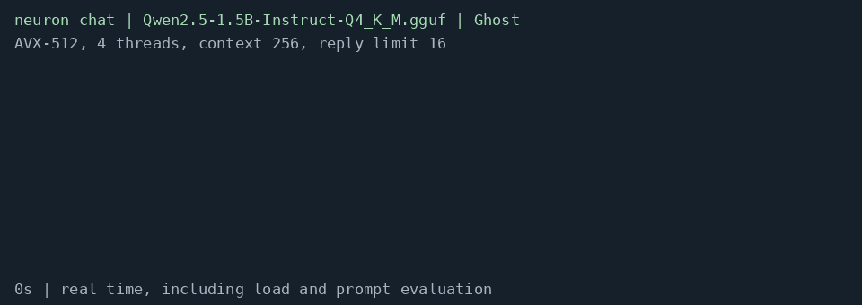

# Neuron

[](https://github.com/DanielMellen-University/Neuron/actions/workflows/ci.yml)
[](LICENSE)

Neuron is a from-scratch C++20 LLM inference engine for x86-64 Linux CPUs.
It reads GGUF weights and generates text without an inference library, GPU
runtime or BLAS dependency. It has terminal chat, a web chat page and a local
OpenAI-compatible API. llama.cpp is an external reference used for checks
and quantization.

The engine works with TinyStories, SmolLM2 Instruct and Qwen2.5 Instruct.
It remains substantially slower than llama.cpp on the target Qwen model.
The [benchmark records](bench/M7_CHECKS.md) and [design post](docs/blog/design-and-optimization.md)
explain the results and the missed targets.

## Quick start

Use x86-64 Linux, CMake, Python and GCC or Clang with C++20 support.
The [checked toolchain and defaults](bench/M7_CHECKS.md#build-and-runtime-contract)
include GCC 11 and Clang 14. No models are needed to build and run unit tests.

```sh
git clone https://github.com/DanielMellen-University/Neuron.git
cd Neuron
cmake -S . -B build -DCMAKE_CXX_COMPILER=g++
cmake --build build -j 2
ctest --test-dir build --output-on-failure
./build/neuron --version

# Keep weights outside the clone. Downloads need curl and sha256sum.
export NEURON_MODELS_DIR="$HOME/.cache/neuron/models"
scripts/fetch_models.sh
./build/neuron run -m "$NEURON_MODELS_DIR/stories15M.gguf" \
  -p "Once upon a time" -n 32 --greedy --threads 4
./build/neuron chat -m "$NEURON_MODELS_DIR/SmolLM2-135M-Instruct-f16.gguf" \
  --threads 4
```

The fetch script verifies pinned hashes and reuses valid files. It downloads
TinyStories F32, SmolLM2 F16 and Qwen2.5 F16. It does not download quantized
Qwen weights. Filenames, hashes and commands are in [the baseline](bench/BASELINE.md)
and [quantization notes](bench/QUANT.md).

For the Qwen chat model used in the demo, build the pinned external quantizer
and produce Q4_K_M from the downloaded F16 file:

```sh
export NEURON_LLAMACPP_DIR="$HOME/.cache/neuron/llama.cpp"
scripts/build_llamacpp.sh
cmake --build "$NEURON_LLAMACPP_DIR/build" --target llama-quantize -j 2
"$NEURON_LLAMACPP_DIR/build/bin/llama-quantize" \
  "$NEURON_MODELS_DIR/Qwen2.5-1.5B-Instruct-f16.gguf" \
  "$NEURON_MODELS_DIR/Qwen2.5-1.5B-Instruct-Q4_K_M.gguf" Q4_K_M 2
./build/neuron chat -m "$NEURON_MODELS_DIR/Qwen2.5-1.5B-Instruct-Q4_K_M.gguf" \
  --threads 4
```

Chat applies the built-in C++ ChatML template, including Qwen's default
system text. `/reset` clears history, `/exit` quits, and Ctrl-C stops the
current reply while keeping the session open. `--system "Reply briefly."`
replaces the system prompt. The [chat checks](bench/M6_CHECKS.md) cover
history, interruption and the template fixtures.

## Demo



Recorded from `neuron chat` on Ghost at real time, including model load and
prompt evaluation. The full [timed transcript](bench/reference/m7-demo.json)
and [recording method](docs/demo.md) are committed. The demo uses a short
reply limit; the quick start uses the normal defaults.

## Speed on Ghost

All rates below are tokens/s with four threads in both engines. Ghost has
an Intel i5-1135G7, four cores, eight hardware threads and 16 GB RAM.
Neuron uses AVX-512; llama.cpp uses its native CPU build at pinned commit
`9e9619d`. See [hardware, power state and methodology](bench/M7_CHECKS.md#speed-table).
`pp` means prompt processing; `tg` means generation after the first sampled
token. Model loading is excluded.

<!-- speed-table -->
| Model | GGUF | Neuron pp | Neuron tg | llama.cpp pp | llama.cpp tg | Records |
| --- | --- | ---: | ---: | ---: | ---: | --- |
| TinyStories 15M | F32 | 1048.75 | 445.18 | 7980.83 | 634.81 | [N](bench/reference/tinystories-m5.json) / [L](bench/reference/tinystories-15m.json) |
| SmolLM2 135M Instruct | F16 | 86.68 | 72.39 | 181.81 | 145.18 | [N](bench/reference/m7-speed-smollm-neuron.json) / [L](bench/reference/m7-speed-smollm-llama.json) |
| Qwen2.5 1.5B Instruct | F16 | 7.87 | 7.00 | 45.35 | 14.31 | [N](bench/reference/m7-speed-f16-neuron.json) / [L](bench/reference/m7-speed-f16-llama.json) |
| Qwen2.5 1.5B Instruct | Q8_0 | 8.68 | 7.97 | 42.16 | 25.27 | [N](bench/reference/m7-speed-q8_0-neuron.json) / [L](bench/reference/m7-speed-q8_0-llama.json) |
| Qwen2.5 1.5B Instruct | Q4_0 | 6.37 | 6.42 | 117.67 | 44.53 | [N](bench/reference/m7-speed-q4_0-neuron.json) / [L](bench/reference/m7-speed-q4_0-llama.json) |
| Qwen2.5 1.5B Instruct | Q4_K_M | 6.48 | 4.29 | 59.26 | 38.95 | [N](bench/reference/m5-speed-final.json) / [L](bench/reference/m5-speed-llama.json) |
<!-- /speed-table -->

TinyStories pools the original prompt set across three repetitions and
128 generated tokens per sample. The other rows use one raw prompt,
`Once upon a time`, with 32 generated tokens and no warmup. These are short
samples collected at different times, without fixed frequency or temperature.
They do not measure chat latency or sustained throughput. Prompt processing
in Neuron evaluates tokens sequentially; llama.cpp can batch them.
[The derived table](bench/reference/m7-benchmarks.json) points to every input
record. N and L link directly to Neuron and llama.cpp timings.

To repeat a short pair after the build and model setup above:

```sh
python3 bench/speed.py measure --binary build/neuron --step recheck \
  --isa avx512 --threads 4 --output bench/runs/qwen-neuron.json \
  --notes 'Record actual load and power conditions.'
python3 bench/speed.py measure --llama --step llama.cpp --threads 4 \
  --output bench/runs/qwen-llama.json \
  --notes 'Record actual load and power conditions.'
# Add --model-file "$NEURON_MODELS_DIR/<filename>.gguf" for another table row.
# Rebuild the displayed table from committed records without running models:
python3 bench/m7_table.py --output bench/runs/m7-benchmarks.json
```

[Exact commands for every row](bench/M7_CHECKS.md#reproduce) include
TinyStories and model preparation. [The M5 speed record](bench/SPEED.md)
keeps the optimization chart and historical source commits.

## What is implemented

- Checked GGUF loading with mapped F32 and Q8_0, Q4_0, Q4_K and Q6_K matrices.
  F16 weights are converted to FP32 when loaded.
- Dense Llama and Qwen2 forward passes with RMSNorm, RoPE, grouped-query
  attention, QKV bias where needed, SwiGLU and a per-layer FP32 KV cache.
- Llama score-based tokenization and Qwen2/SmolLM2 byte BPE, including
  Unicode pre-tokenization and special tokens.
- Scalar, AVX2, AVX-512 and VNNI matrix kernels with runtime CPU/OS checks
  and a persistent thread pool splitting output rows.
- Greedy generation, streaming terminal and web chat, JSON token/timing
  output, logit export, reference checks and chunked perplexity evaluation.

One default build contains all kernel variants. `--isa auto` selects
AVX-512, then AVX2, then scalar. VNNI is explicitly selectable and was slower
in this implementation. `--threads` and `--isa` override `NEURON_THREADS`
and `NEURON_ISA`. [Runtime settings](bench/SPEED.md#kernels-and-threads) also
apply to library callers.

## Web chat and API

```sh
./build/neuron serve -m "$NEURON_MODELS_DIR/Qwen2.5-1.5B-Instruct-Q4_K_M.gguf" \
  --threads 4 --port 8080
# Open http://127.0.0.1:8080 for the embedded web chat page.
```

The server defaults to loopback and needs no frontend build or CDN.
It provides `GET /v1/models` and `POST /v1/chat/completions`, with normal
JSON or streaming SSE responses. The official Python client works with
its normal methods:

```python
from openai import OpenAI

client = OpenAI(base_url="http://127.0.0.1:8080/v1", api_key="local")
model = client.models.list().data[0].id
for chunk in client.chat.completions.create(
    model=model,
    messages=[{"role": "user", "content": "Say hello briefly."}],
    max_tokens=32,
    stream=True,
):
    print(chunk.choices[0].delta.content or "", end="", flush=True)
```

Install `openai` in a separate Python environment to use this example.
Omit `stream=True` for a complete response with token usage. Send the full
history each time. [API behavior, supported fields and client checks](bench/M6_CHECKS.md)
include the local SDK test command.

## Limitations

- **M4 missed both free-running agreement targets.** Against F16, Q8_0
  matched 551/768 tokens (71.74%, target 90%); Q4_K_M matched 180/768
  (23.44%, target 70%). Per-format perplexity still tracked llama.cpp
  within 0.9%. These accepted misses remain documented in
  [the quality record](bench/QUANT.md#second-round-4096-targets-and-twelve-prompts).
- **M5 missed the speed target.** Q4_K_M generation was 4.294374 tokens/s
  versus llama.cpp's 38.953875, or 11.02%, against a 50% target at the same
  thread count. [The final samples](bench/SPEED.md) remain the comparison.
- **Restricted models and formats.** Dense Llama and Qwen2 only; the
  locally checked models are the table above. No MoE, RoPE scaling, other
  quantization formats, arbitrary Jinja templates or multimodal inputs.
- **Greedy decoding only.** No temperature sampling, top-p sampling,
  tools or custom stop strings. The API implements a subset of OpenAI's
  interface and serves one request at a time, without authentication or TLS.
- **Context and memory costs.** F16 expands to FP32 in memory. Chat
  re-evaluates the full history each turn. The CLI defaults to context
  2048 and rejects overflow; it does not truncate or slide history.
  TinyStories declares a training context of 128; use `--ctx-size 128`
  with a smaller prompt/output budget to stay inside it. An override
  makes no quality claim beyond a model's training context.
- **Platform scope.** x86-64 Linux CPUs only. No GPU backends or builds
  for ARM, macOS or Windows.

Defaults and platform scope are recorded in [the runtime contract](bench/M7_CHECKS.md#build-and-runtime-contract).

## Tests and docs

```sh
cmake -S . -B build-check -DCMAKE_CXX_COMPILER=g++ -DNEURON_WERROR=ON
cmake --build build-check -j 2
ctest --test-dir build-check --output-on-failure
```

Unit tests and model-free HTTP/terminal tests need no weights or reference
engine. The optional official-client integration test skips when its model
or Python package is absent. [CI](.github/workflows/ci.yml) checks GCC and
Clang Release builds, AVX2, an AVX-512 build, ASan/UBSan, and a weights/size
guard. [M7 checks](bench/M7_CHECKS.md) record local results.

Start at the [docs hub](docs/README.md) for the design post, demo method,
benchmark reproduction and milestone records. [ROADMAP.md](ROADMAP.md)
preserves the acceptance criteria. Source lives in `src/`, public headers
in `include/neuron/`, tests in `tests/` and measurement tools in `bench/`.

[MIT license](LICENSE). [Unicode data license](LICENSE-UNICODE.txt).
