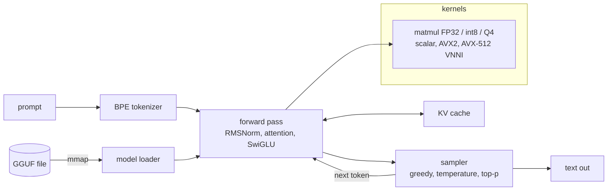

# Neuron

[](https://github.com/DanielMellen-University/Neuron/actions/workflows/ci.yml)


[](LICENSE)

**A from-scratch C++ LLM inference engine for x86 CPUs.**

Neuron loads a small transformer language model and generates text on a laptop CPU, with no GPU and no inference libraries underneath. The target machine is an Intel i5-1135G7 (4 cores, 8 threads, 16 GB RAM, AVX2 and AVX-512 with VNNI). The end goal is Qwen2.5 1.5B Instruct, quantized to 4 bits, chatting at a usable speed.

> **Status: in progress.** Today the repo has the build, CI, a test harness, and a tensor shape type. Nothing below under "Planned features" works yet. [ROADMAP.md](ROADMAP.md) tracks each milestone and what "done" means for it.

## Planned features

- **GGUF model loading** with memory-mapped weights, starting with TinyStories and SmolLM2 and ending with Qwen2.5 1.5B Instruct.
- **A BPE tokenizer** that matches the reference tokenizer token for token.
- **A plain FP32 forward pass** (RMSNorm, RoPE, grouped-query attention, SwiGLU) checked against llama.cpp logits.
- **KV cache and chat templates** for multi-turn conversation.
- **int8 and 4-bit quantization** with a measured quality check against FP32.
- **AVX-512 and VNNI kernels plus multithreading**, with a speed chart for every optimization step.
- **Three front ends**: a terminal chat, a small web chat UI, and an OpenAI-compatible local HTTP server.

## Quick start

Requires CMake 3.20+ and GCC 11+ or Clang 14+ on x86-64 Linux.

```
git clone https://github.com/DanielMellen-University/Neuron.git
cd Neuron
cmake -S . -B build                # Release by default
cmake --build build -j
ctest --test-dir build --output-on-failure
./build/neuron --version
```

Build options:

| Option | Default | Effect |
| --- | --- | --- |
| `NEURON_AVX2` | `OFF` | Compile with AVX2, FMA, and F16C |
| `NEURON_AVX512` | `OFF` | Compile with AVX-512 F/BW/DQ/VL/VNNI (implies AVX2) |
| `NEURON_NATIVE` | `OFF` | Compile with `-march=native` |
| `NEURON_WERROR` | `OFF` | Treat warnings as errors (CI turns this on) |
| `NEURON_SANITIZE` | `OFF` | AddressSanitizer and UndefinedBehaviorSanitizer |
| `NEURON_BUILD_TESTS` | `ON` | Build the unit tests |

`./build/neuron --version` prints the instruction sets the binary was built for, for example `neuron 0.1.0 (avx512f avx512vnni avx2 fma)`.

Model weights are never committed. When model support lands, a download script will put them in the git-ignored `models/` directory.

## How it will work



1. The loader maps the GGUF file and reads the tensor table, so weights are paged in from disk instead of copied.
2. The tokenizer turns the prompt into token ids.
3. Each forward pass runs one token through every transformer layer and appends that token's keys and values to the KV cache, so earlier tokens are not recomputed.
4. The sampler picks the next token from the logits and feeds it back in.
5. Almost all of the time goes into matrix-vector products. Those live in small kernels with a scalar reference version and SIMD versions that are tested against it.

## Limitations

These are true today and some will stay true by design.

- **Not functional yet.** There is no model loading or text generation. The `neuron` binary only prints its version and help.
- **x86-64 Linux only.** No ARM, macOS, or Windows builds are planned.
- **CPU only.** No CUDA, Metal, or Vulkan.
- **Small models.** The engine targets models up to about 1.5B parameters that fit in 16 GB of RAM.
- **Single user.** The planned server handles one conversation at a time; there is no batching across requests.

## Testing

```
cmake -S . -B build -DNEURON_WERROR=ON
cmake --build build -j
ctest --test-dir build --output-on-failure
```

Tests use a small header-only framework in [tests/neuron_test.hpp](tests/neuron_test.hpp) (registration, `CHECK`/`REQUIRE` macros, and a runner) driven by CTest, so there are no third-party test dependencies. CI builds and tests with GCC and Clang, with and without AVX2, runs an ASan and UBSan job, checks that the AVX-512 build compiles, and rejects any committed weight file.

## Project layout

```
include/neuron/     public headers (tensor.hpp, version.hpp)
src/                library sources and the neuron CLI
tests/              unit tests and the test framework
.github/workflows/  CI
ROADMAP.md          milestones and acceptance criteria
```

## Docs

- [ROADMAP.md](ROADMAP.md): milestones M1 to M7 and their acceptance criteria
- [LICENSE](LICENSE): MIT
