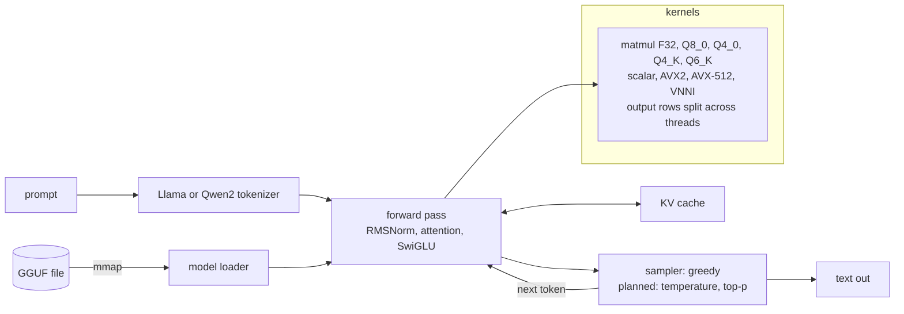

# Neuron

[](https://github.com/DanielMellen-University/Neuron/actions/workflows/ci.yml)


[](LICENSE)

**A from-scratch C++ LLM inference engine for x86 CPUs.**

Neuron loads a small transformer language model and generates text on a laptop CPU, with no GPU and no inference libraries underneath. The target machine is an Intel i5-1135G7 (4 cores, 8 threads, 16 GB RAM, AVX2 and AVX-512 with VNNI). The end goal is Qwen2.5 1.5B Instruct, quantized to 4 bits, chatting at a usable speed.

> **Status: M6 implemented.** Terminal chat, an embedded web chat page and a local OpenAI-compatible server work with Qwen2.5 and SmolLM2 Instruct. [M6 checks](bench/M6_CHECKS.md) record the results. M5's speed target was missed and accepted: Q4_K_M generation is 4.294 tokens/s versus llama.cpp's 38.954 with four threads (11.02%). [Speed checks](bench/SPEED.md) and [quantization checks](bench/QUANT.md) preserve the M4 and M5 results.

## Current features

- **GGUF loading** with checked metadata and tensor tables, mapped F32/Q8_0/Q4_0/Q4_K/Q6_K weights and F16 weights converted to FP32.
- **Llama, Qwen2 and SmolLM2 tokenizers** with score-based merging or byte BPE, Unicode pre-tokenization and special tokens.
- **FP32 inference** for Llama and Qwen2 with RMSNorm, adjacent-pair or split-half RoPE, GQA, QKV bias and SwiGLU.
- **Runtime SIMD kernels** for F32, Q8_0, Q4_0, Q4_K and Q6_K matmuls and dot products, with scalar references and explicit ISA selection.
- **Persistent matmul thread pool** with configurable splitting by output rows.
- **Per-layer KV cache** with checked context bounds.
- **Qwen2.5 ChatML** with a default or explicit system prompt and multi-turn message history.
- **Terminal chat** with streaming output, `/reset`, `/exit` and Ctrl-C to stop a reply.
- **Local HTTP server** with streaming and non-streaming chat completions, model listing and an embedded web chat page.
- **Greedy CLI generation** with streaming text, JSON token IDs, top-two logit gaps and reference checks.
- **Perplexity evaluation** with fixed context chunks and a pinned short quality check.

## Quick start

Requires CMake 3.20+, Python 3.8+ for tests, and GCC 11+ or Clang 14+ on x86-64 Linux.

```
git clone https://github.com/DanielMellen-University/Neuron.git
cd Neuron
cmake -S . -B build                # Release by default
cmake --build build -j
ctest --test-dir build --output-on-failure
./build/neuron --version
```

Build options:

| Option | Default | Effect |
| --- | --- | --- |
| `NEURON_AVX2` | `OFF` | Compatibility option; AVX2 kernels are always compiled with function target attributes |
| `NEURON_AVX512` | `OFF` | Compatibility option; AVX-512 and VNNI kernels are always compiled with function target attributes |
| `NEURON_NATIVE` | `OFF` | Compatibility option; baseline code keeps its portable x86-64 target |
| `NEURON_WERROR` | `OFF` | Treat warnings as errors (CI turns this on) |
| `NEURON_SANITIZE` | `OFF` | AddressSanitizer and UndefinedBehaviorSanitizer |
| `NEURON_BUILD_TESTS` | `ON` | Build the unit tests |

`./build/neuron --version` prints the compiled kernel variants, selected runtime
ISA and thread count. One default build works on CPUs without AVX-512.
Runtime checks include CPU and OS support before calling a SIMD kernel.

Model weights are never committed. `scripts/fetch_models.sh` downloads pinned TinyStories 15M F32, SmolLM2 135M Instruct F16 and Qwen2.5 1.5B Instruct F16 GGUF files into the git-ignored `models/` directory and checks their SHA-256 hashes. Set `NEURON_MODELS_DIR` to use another directory.

Generate with the validated TinyStories model:

```sh
scripts/fetch_models.sh
./build/neuron run -m models/stories15M.gguf -p "Once upon a time" -n 128 --greedy
# Emit prompt/generated IDs and timings instead of text:
./build/neuron run -m models/stories15M.gguf -p "Once upon a time" -n 128 --greedy --json
./build/neuron tokenize -m models/stories15M.gguf -p "Hello world"
```

Run Qwen2.5 with its ChatML template:

```sh
./build/neuron run -m models/Qwen2.5-1.5B-Instruct-f16.gguf \
  --chat -p "Say hello briefly." -n 32 --greedy
# Supply a system prompt and previous messages for a later turn:
./build/neuron run -m models/Qwen2.5-1.5B-Instruct-f16.gguf \
  --system "Reply briefly." \
  --message user "My name is Ada." --message assistant "Hello Ada." \
  -p "What is my name?" -n 32 --greedy
```

`--message ROLE TEXT` supplies history in order; `-p` adds the final user
message in chat mode. Omit `--system` to use the model's default system text.
`neuron template` prints the rendered ChatML prompt with the same message
flags, and `neuron tokenize` prints its IDs. `--prompt-file FILE` reads prompt
bytes instead of `-p`. These commands support text-only Qwen2.5 chat.
Qwen's F16 weights are upcast to
FP32. Q8_0, Q4_0, Q4_K and Q6_K matrices stay mapped and decode during products.
[Quantization checks](bench/QUANT.md) document how to produce these GGUFs
with the pinned external llama.cpp quantizer and compare their quality.

Chat in a terminal or start the web UI and API:

```sh
export NEURON_MODELS_DIR=/path/to/models
./build/neuron chat -m "$NEURON_MODELS_DIR/Qwen2.5-1.5B-Instruct-Q4_K_M.gguf" --threads 4
./build/neuron serve -m "$NEURON_MODELS_DIR/Qwen2.5-1.5B-Instruct-Q4_K_M.gguf" --threads 4 --port 8080
# Open http://127.0.0.1:8080 for web chat.
```

Chat supports `-n` (default 128), `--ctx-size` (default 2048) and `--system`.
Ctrl-C interrupts prompt processing or generation and keeps the session open.
`/reset` clears history. The server defaults to `127.0.0.1`; `--host` selects
an explicit IPv4 bind address. Ctrl-C stops the server.

Use the official Python client with its normal methods:

```python
from openai import OpenAI

client = OpenAI(base_url="http://127.0.0.1:8080/v1", api_key="local")
model = client.models.list().data[0].id
for chunk in client.chat.completions.create(
    model=model, messages=[{"role": "user", "content": "Say hello briefly."}],
    max_tokens=32, stream=True,
):
    print(chunk.choices[0].delta.content or "", end="", flush=True)
```

Omit `stream=True` for a complete response with token usage. The model ID is
the loaded GGUF filename. Send the full message history with each request.
The API supports text messages with system, user and assistant roles, greedy
decoding, `max_tokens` or `max_completion_tokens`, and optional streaming
usage. Sampling, tools, custom stop strings and multimodal messages are not
supported. Context overflow and bad JSON return HTTP 400; unknown models
return 404, with OpenAI-shaped error objects. Requests run one at a time.

`python3 scripts/test_openai_client.py --binary build/neuron` starts a server
and checks the official client with the Q4_K_M model from `NEURON_MODELS_DIR`.
It exits 77 with a skip reason when the model or `openai` package is missing.
`--model FILE` selects SmolLM2 or another supported chat model.

Evaluate the fixed WikiText-2 slice with a quantized model:

```sh
./build/neuron perplexity -m models/Qwen2.5-1.5B-Instruct-Q4_0.gguf \
  --prompt-file bench/wikitext2-m4-v2.txt --ctx-size 512 --chunks 16
```

This resets the cache between chunks and scores each chunk's second half.
It writes JSON with loss, perplexity, counts and input token IDs. Omit
`--chunks` to evaluate all complete chunks; an incomplete tail is ignored.

The CLI defaults to a 2048-token context to match M1. TinyStories declares only 128 training tokens; `--ctx-size 128` enforces that smaller limit. A prompt plus requested generation exceeding the selected limit is rejected. The override leaves the model file unchanged and makes no quality claim beyond its training context.

To compare Neuron with the committed M1 tokens:

```sh
python3 bench/harness.py run-neuron --binary build/neuron \
  --model-file models/stories15M.gguf --output bench/runs/tinystories.json \
  --notes 'Describe the actual machine load and power state.'
python3 bench/harness.py compare bench/reference/tinystories-15m.json \
  bench/runs/tinystories.json --threads 1 --exact-match
```

`run-neuron --threads N --isa PATH` sets Neuron's execution settings. The
compare command's `--threads N` selects the corresponding reference rows.
[bench/M2_CHECKS.md](bench/M2_CHECKS.md) also documents the full-vocabulary logit check and tokenizer fixtures. [M3 checks](bench/M3_CHECKS.md) provide the separate Qwen tokenizer, ChatML, greedy and memory commands.

Matmuls default to one thread and `--isa auto`. Auto selects AVX-512, then
AVX2, then scalar. VNNI is available explicitly; its precision-preserving
activation packing was slower on Ghost. Select a path and thread count:

```sh
./build/neuron run -m "$NEURON_MODELS_DIR/Qwen2.5-1.5B-Instruct-Q4_K_M.gguf" \
  -p "Once upon a time" -n 32 --greedy --isa avx512 --threads 4
# Environment defaults also apply to library callers and perplexity:
NEURON_ISA=scalar NEURON_THREADS=1 ./build/neuron --version
```

`NEURON_ISA=auto|scalar|avx2|avx512|vnni` and `NEURON_THREADS=1..256` set
defaults; CLI flags override them. An explicitly requested unavailable ISA
returns an error. Configure library execution before starting inference.

The [llama.cpp baseline](bench/BASELINE.md) has measured speeds, reference tokens, and exact commands to build and run the external reference engine. This requires Python 3.8+, Git, curl, GCC and CMake. `python3 bench/harness.py compare reference.json candidate.json --exact-match` compares prompt and generated token IDs and reports speed ratios. The comparison tests run without models or llama.cpp.

## Inference path and planned extensions



1. The loader maps the GGUF file and checks its tensor table. F32 and quantized matrices stay mapped; F16 weights are converted to FP32 once on load.
2. The tokenizer turns the prompt into token ids.
3. Each forward pass runs one token through every transformer layer and appends that token's keys and values to the KV cache, so earlier tokens are not recomputed.
4. The sampler picks the next token from the logits and feeds it back in.
5. Matrix-vector products use runtime-selected kernels, checked against scalar references. The thread pool assigns independent output rows to workers.

## Limitations

These are true today and some will stay true by design.

- **Dense Llama and Qwen2 F32/F16/Q8_0/Q4_0/Q4_K/Q6_K models only.** TinyStories and Qwen2.5 1.5B Instruct are the local check targets. Other tokenizer families, other quantization formats, RoPE scaling and tool-call chat templates are not supported.
- **Generation speed below the M5 target.** The measured ratio and remaining gap are in [bench/SPEED.md](bench/SPEED.md).
- **x86-64 Linux only.** No ARM, macOS, or Windows builds are planned.
- **CPU only.** No CUDA, Metal, or Vulkan.
- **Small models.** The engine targets models up to about 1.5B parameters that fit in 16 GB of RAM.
- **Single user.** The server handles one request at a time, with no batching, authentication or TLS.

## Testing

```
cmake -S . -B build -DNEURON_WERROR=ON
cmake --build build -j
ctest --test-dir build --output-on-failure
```

GGUF, tokenizer, kernel and synthetic transformer tests run without models or llama.cpp. C++ tests use a small header-only framework in [tests/neuron_test.hpp](tests/neuron_test.hpp) (registration, `CHECK`/`REQUIRE` macros, and a runner) driven by CTest. Harness comparison tests use Python 3.8+ and its standard library. There are no third-party test dependencies. CI builds and tests with GCC and Clang, with and without AVX2, runs an ASan and UBSan job, checks that the AVX-512 build compiles, and rejects any committed weight file.

HTTP and terminal tests use a tiny fake backend and real loopback sockets or
subprocesses. They run in CI without weights or the optional Python client.

## Project layout

```
include/neuron/     GGUF, tokenizer, model, kernels, shape and version headers
src/                library sources and the neuron CLI
tests/              unit tests and the test framework
scripts/            pinned model downloads and external llama.cpp build
bench/              prompts, reference tokens, comparison harness and baseline
.github/workflows/  CI
ROADMAP.md          milestones and acceptance criteria
```

## Docs

- [ROADMAP.md](ROADMAP.md): milestones M1 to M7 and their acceptance criteria
- [bench/BASELINE.md](bench/BASELINE.md): llama.cpp reference measurements and reproduction
- [bench/M2_CHECKS.md](bench/M2_CHECKS.md): TinyStories tokenizer, logits and exact generation checks
- [bench/M3_CHECKS.md](bench/M3_CHECKS.md): Qwen2.5, ChatML, cache, context and memory checks
- [bench/QUANT.md](bench/QUANT.md): Q8_0/Q4_0/Q4_K/Q6_K formats, perplexity and greedy agreement
- [bench/SPEED.md](bench/SPEED.md): SIMD, threading, per-step speed chart and correctness guards
- [bench/M6_CHECKS.md](bench/M6_CHECKS.md): terminal chat, HTTP, web UI and official client checks
- [LICENSE](LICENSE): MIT
