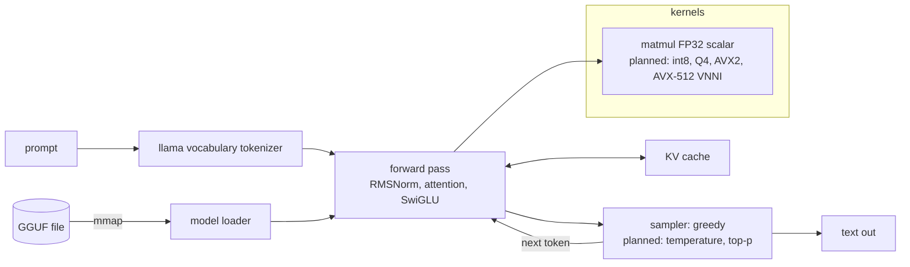

# Neuron

[](https://github.com/DanielMellen-University/Neuron/actions/workflows/ci.yml)


[](LICENSE)

**A from-scratch C++ LLM inference engine for x86 CPUs.**

Neuron loads a small transformer language model and generates text on a laptop CPU, with no GPU and no inference libraries underneath. The target machine is an Intel i5-1135G7 (4 cores, 8 threads, 16 GB RAM, AVX2 and AVX-512 with VNNI). The end goal is Qwen2.5 1.5B Instruct, quantized to 4 bits, chatting at a usable speed.

> **Status: M2 complete locally.** Neuron generates TinyStories text with a scalar FP32 forward pass. Its tokenizer matches llama.cpp on 51 prompt and edge cases, its final-position logits match within 1e-3, and all three M1 prompts produce the exact same 128 generated token IDs. [M2 checks](bench/M2_CHECKS.md) record the results and commands. [ROADMAP.md](ROADMAP.md) tracks what exists and what comes next.

## Current features

- **GGUF loading** with checked metadata and tensor tables, mapped F32 weights and F16 weights converted to FP32.
- **Llama vocabulary tokenizer** with scores, special tokens and byte fallback.
- **Scalar FP32 inference** with RMSNorm, adjacent-pair RoPE, causal attention, grouped-query attention and SwiGLU.
- **Greedy CLI generation** with streaming text, JSON token IDs and a reference comparison harness.

## Planned features

- Qwen2.5 model support, GPT-style BPE vocabularies, chat templates and multi-turn state.
- int8 and 4-bit quantization with a measured quality check against FP32.
- AVX-512 and VNNI kernels plus multithreading, with a speed chart for each optimization step.
- Terminal chat, a small web chat UI and an OpenAI-compatible local HTTP server.

## Quick start

Requires CMake 3.20+, Python 3.8+ for tests, and GCC 11+ or Clang 14+ on x86-64 Linux.

```
git clone https://github.com/DanielMellen-University/Neuron.git
cd Neuron
cmake -S . -B build                # Release by default
cmake --build build -j
ctest --test-dir build --output-on-failure
./build/neuron --version
```

Build options:

| Option | Default | Effect |
| --- | --- | --- |
| `NEURON_AVX2` | `OFF` | Compile with AVX2, FMA, and F16C |
| `NEURON_AVX512` | `OFF` | Compile with AVX-512 F/BW/DQ/VL/VNNI (implies AVX2) |
| `NEURON_NATIVE` | `OFF` | Compile with `-march=native` |
| `NEURON_WERROR` | `OFF` | Treat warnings as errors (CI turns this on) |
| `NEURON_SANITIZE` | `OFF` | AddressSanitizer and UndefinedBehaviorSanitizer |
| `NEURON_BUILD_TESTS` | `ON` | Build the unit tests |

`./build/neuron --version` prints the instruction sets the binary was built for, for example `neuron 0.1.0 (avx512f avx512vnni avx2 fma)`.

Model weights are never committed. `scripts/fetch_models.sh` downloads pinned TinyStories 15M F32 and SmolLM2 135M Instruct F16 GGUF files into the git-ignored `models/` directory and checks their SHA-256 hashes. Set `NEURON_MODELS_DIR` to use another directory.

Generate with the validated TinyStories model:

```sh
scripts/fetch_models.sh
./build/neuron run -m models/stories15M.gguf -p "Once upon a time" -n 128 --greedy
# Emit prompt/generated IDs and timings instead of text:
./build/neuron run -m models/stories15M.gguf -p "Once upon a time" -n 128 --greedy --json
./build/neuron tokenize -m models/stories15M.gguf -p "Hello world"
```

The CLI defaults to a 2048-token context to match M1. TinyStories declares only 128 training tokens; `--ctx-size 128` enforces that smaller limit. A prompt plus requested generation exceeding the selected limit is rejected. The override leaves the model file unchanged and makes no quality claim beyond its training context.

To compare Neuron with the committed M1 tokens:

```sh
python3 bench/harness.py run-neuron --binary build/neuron \
  --model-file models/stories15M.gguf --output bench/runs/tinystories.json \
  --notes 'Describe the actual machine load and power state.'
python3 bench/harness.py compare bench/reference/tinystories-15m.json \
  bench/runs/tinystories.json --threads 1 --exact-match
```

Neuron currently uses one thread. `--threads 1` selects the corresponding reference rows; it does not change Neuron's execution. [bench/M2_CHECKS.md](bench/M2_CHECKS.md) also documents the full-vocabulary logit check and tokenizer fixtures.

The [llama.cpp baseline](bench/BASELINE.md) has measured speeds, reference tokens, and exact commands to build and run the external reference engine. This requires Python 3.8+, Git, curl, GCC and CMake. `python3 bench/harness.py compare reference.json candidate.json --exact-match` compares prompt and generated token IDs and reports speed ratios. The comparison tests run without models or llama.cpp.

## Inference path and planned extensions



1. The loader maps the GGUF file and checks its tensor table. F32 weights stay mapped; F16 weights are converted to FP32 once on load.
2. The tokenizer turns the prompt into token ids.
3. Each forward pass runs one token through every transformer layer and appends that token's keys and values to the KV cache, so earlier tokens are not recomputed.
4. The sampler picks the next token from the logits and feeds it back in.
5. Matrix-vector products use scalar reference kernels. Later SIMD kernels will be checked against those references.

## Limitations

These are true today and some will stay true by design.

- **TinyStories is the validated model.** The loader supports dense llama F32/F16 tensors, and the tokenizer supports llama vocabularies. Other tokenizer families, quantized weights and RoPE scaling are not supported yet.
- **Scalar and single-threaded.** There are no optimized SIMD kernels, chat interface or server yet.
- **x86-64 Linux only.** No ARM, macOS, or Windows builds are planned.
- **CPU only.** No CUDA, Metal, or Vulkan.
- **Small models.** The engine targets models up to about 1.5B parameters that fit in 16 GB of RAM.
- **Single user.** The planned server handles one conversation at a time; there is no batching across requests.

## Testing

```
cmake -S . -B build -DNEURON_WERROR=ON
cmake --build build -j
ctest --test-dir build --output-on-failure
```

GGUF, tokenizer, kernel and synthetic transformer tests run without models or llama.cpp. C++ tests use a small header-only framework in [tests/neuron_test.hpp](tests/neuron_test.hpp) (registration, `CHECK`/`REQUIRE` macros, and a runner) driven by CTest. Harness comparison tests use Python 3.8+ and its standard library. There are no third-party test dependencies. CI builds and tests with GCC and Clang, with and without AVX2, runs an ASan and UBSan job, checks that the AVX-512 build compiles, and rejects any committed weight file.

## Project layout

```
include/neuron/     GGUF, tokenizer, model, kernels, shape and version headers
src/                library sources and the neuron CLI
tests/              unit tests and the test framework
scripts/            pinned model downloads and external llama.cpp build
bench/              prompts, reference tokens, comparison harness and baseline
.github/workflows/  CI
ROADMAP.md          milestones and acceptance criteria
```

## Docs

- [ROADMAP.md](ROADMAP.md): milestones M1 to M7 and their acceptance criteria
- [bench/BASELINE.md](bench/BASELINE.md): llama.cpp reference measurements and reproduction
- [bench/M2_CHECKS.md](bench/M2_CHECKS.md): tokenizer, logits, exact generation checks and reproduction
- [LICENSE](LICENSE): MIT
