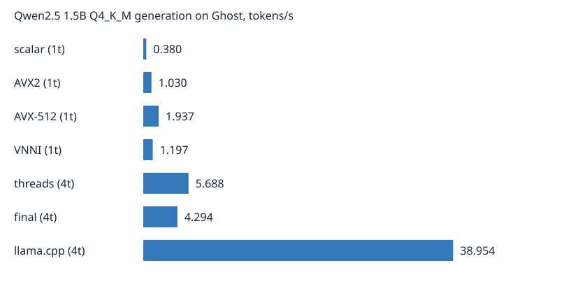

# M5 speed and correctness

This is the speed and kernel-correctness record for the M5 optimizations. Use it for the step-by-step chart, the comparison with llama.cpp, and the SIMD tests (AVX2, AVX-512 and VNNI are CPU vector instruction sets). tok/s is tokens per second.

M5 is implemented. The speed target was missed and accepted. The final Qwen2.5 1.5B
Q4_K_M run generated **4.294374 tokens/s**, versus **38.953875 tokens/s** for
llama.cpp with the same file and four threads: **11.02%**. The target is
50%, or 19.476937 tokens/s in this comparison. That speed target was missed.
No further speed tuning was attempted after these checks.

## Optimization steps



| Step | Source commit | ISA | Threads | Generation tokens/s |
| --- | --- | --- | ---: | ---: |
| scalar | `8c8a1fd` | scalar | 1 | [0.379682](reference/m5-speed-scalar.json) |
| AVX2 | `7434675` | avx2 | 1 | [1.030390](reference/m5-speed-avx2.json) |
| AVX-512 | `a57ff6c` | avx512 | 1 | [1.936931](reference/m5-speed-avx512.json) |
| VNNI | `c05839a` | vnni | 1 | [1.196552](reference/m5-speed-vnni.json) |
| threads | `58fe608` | avx512 | 4 | [5.687839](reference/m5-speed-threads.json) |
| final | `860228a` | avx512 | 4 | [4.294374](reference/m5-speed-final.json) |
| llama.cpp | `9e9619d` | native | 4 | [38.953875](reference/m5-speed-llama.json) |

Each optimization has its own commit. The `source_sha256` in each Neuron record
matches the CMake file, headers and sources at the listed commit. Samples
were collected before committing the corresponding change, so the early
records' `parent_commit` is the preceding commit. The final source also
matches measured HEAD `2efcebd`.

The VNNI path is slower than AVX-512 on this implementation. Auto therefore
selects AVX-512, then AVX2, then scalar; VNNI remains explicitly selectable.
The threads step uses AVX-512. Final repeats that configuration after
settings and test hardening. No arithmetic kernel changed after the
threads step. Each point is one short run. Frequency, temperature and
scheduling were not held fixed; the final recheck was slower than the
original threads sample. The ratio above uses the final sample.

## Measurement method

Measured on 2026-11-17 UTC on an Intel Core i5-1135G7 laptop (4 cores/8
threads, AVX-512 VNNI): 16 GB RAM, AVX2 and AVX-512 with VNNI, Ubuntu 22.04
base, GCC 11.4.0, CMake 3.22.1, Release. Model processes, tests and builds ran
sequentially during speed collection. Other development tools and normal
services were present. AC was connected, the battery was full, the governor was
`powersave`, the driver was `intel_pstate`, and turbo was enabled. Each
record saves observed power and load before and after its run.

Every point uses the raw prompt `Once upon a time`, IDs
`[12522, 5193, 264, 882]`, greedy decoding, 32 generated tokens, context 256,
no warmup run and one repetition. The generation rate is
`1000 * 31 / predicted_ms`: the first sampled token comes from prompt
processing. Model load and prompt evaluation are excluded. All Neuron
steps generated the same 32 IDs. This is a short decode comparison.

The model is the unchanged M4 standard Q4_K_M file, 986,048,512 bytes,
SHA-256 `52e47664d0a0001bd58ffdd16beb6e6a0b3609bbfee7a439a462dc6285a23281`.
It includes Q4_K and Q6_K matrices. [QUANT.md](QUANT.md) records production
commands and the other format hashes. Weights remain outside the repo.

The comparison reuses native CPU-only llama.cpp commit
`9e9619d030bbe6b584d826a0a6cf06e38251f52b`, with four generation and batch
threads, context 256, one slot, no GPU layers, Flash Attention off, and
prompt caching disabled. Decoding uses seed 42, temperature 0, only the
temperature sampler and repetition penalty 1.0. The record includes the
server command, returned IDs and timings. Both engines receive identical
prompt IDs and generate all 32 tokens.

## Kernels and threads

The default binary includes scalar, AVX2, AVX-512 and VNNI functions.
Function target attributes confine SIMD instructions to their kernels;
baseline code has no global AVX flags. Runtime CPU/OS checks guard every
selected path. `NEURON_ISA=auto|scalar|avx2|avx512|vnni` or `--isa` selects a
path. An unavailable explicit path returns an error. The old CMake ISA
options remain compatible and do not change the baseline target.

F32 dots and quantized products use double accumulators. AVX2 and AVX-512
decode Q8_0, Q4_0, Q4_K and Q6_K directly from mapped blocks. VNNI packs
activations into four unsigned byte planes with a power-of-two scale for
each group of 16. Integer dots use `vpdpbusd` and an exact int64 bias
correction. This preserves enough activation precision for the scalar
checks, at the cost of extra instructions and packing. Small values can
round by at most half that group's scale.

The persistent pool assigns disjoint output rows to workers. Each row
keeps the same accumulation order at every thread count. The caller also
works; `--threads N` or `NEURON_THREADS=N` counts it, defaults to 1 and
accepts 1..256. CLI flags override environment defaults. Configure library
settings before starting inference. Norms, softmax, RoPE and the attention
value reduction retain their existing scalar implementations.

## Model-free checks and CI

[Validation results](reference/m5-validation.json) retain configure, build
and verbose CTest logs, settings and binary hashes. All 19 entries passed
in each configuration:

| Compiler and configuration | Result |
| --- | --- |
| GCC default Release | 19/19 |
| GCC Release, Werror | 19/19 |
| GCC Release, Werror, AVX2 | 19/19 |
| GCC Release, Werror, AVX-512 | 19/19 |
| GCC Debug, Werror, ASan/UBSan | 19/19 |
| Clang 14 Release, Werror | 19/19 |
| Clang 14 Release, Werror, AVX2 | 19/19 |

Local Clang uses the explicit GCC 11 header and library flags recorded in
the validation JSON. The AVX2 configurations force `NEURON_ISA=avx2` for
CTest. All AVX-512 and VNNI tests ran on the test laptop without skips.

| Path, GCC Release on the test laptop | Scalar comparisons | Max absolute output difference |
| --- | ---: | ---: |
| scalar | 2,833 | 0 |
| AVX2 | 2,833 | 0 |
| AVX-512 | 2,833 | 0 |
| VNNI | 2,833 | 4.76837158e-7 |

`test_simd` covers random F32 products and dots, all four packed formats,
unaligned blocks, odd row and block counts, batches, cancellation, unequal
activation magnitudes and arbitrary code/scale bytes including signed
-128 values. F32 and integer dots include tails around every vector width;
quantized columns must contain complete GGUF blocks of 32 or 256 elements.
There are also 33 F32 dot checks per path and exact integer dot checks.
The floating output tolerance is `1e-5 * (1 + abs(reference))`. Unsupported
ISA tests return 77 and CTest reports a skip.

`test_threads` passed **93,600 bit-identical output comparisons** across
scalar, AVX2, AVX-512 and VNNI, all five matrix types, batches, row counts 3
and 257, thread counts 1/2/4/8, and repeated jobs. It also rejects zero
threads. CLI tests verify explicit settings override invalid environment
values and reject invalid counts and paths.

[CI](../.github/workflows/ci.yml) forces AVX2 in its GCC/Clang AVX2 jobs,
compiles the AVX-512 functions, runs GCC ASan/UBSan, and checks weights and
file sizes. Local equivalents all pass.
GitHub Actions remains pending. No weight file or file over 1 MiB was added.

## Correctness guards

Debugging first used TinyStories and SmolLM2. The
[AVX2 small-model guard](reference/m5-small-avx2.json) matches scalar and M1
exactly for all three prompts: 384 TinyStories IDs and 96 SmolLM2 IDs.
The final [VNNI, four-thread guard](reference/m5-small-vnni.json) also matches
all those IDs exactly, exercising the AVX-512 dense kernel used by VNNI.

The final [TinyStories runs](reference/tinystories-m5.json) use automatic
AVX-512 with four threads, three prompts, three repetitions and 128 tokens.
[Comparison](reference/m5-m2-generation-compare.json) is **1,152/1,152 exact
M1 IDs**, including identical prompt IDs. The [M2 check](reference/m5-m2.json)
passes all 51 tokenizer cases and all vocabulary logits for three prompts,
with maximum absolute logit error 9.5367431640625e-6. The final
[M3 fixtures-only check](reference/m5-m3.json) passes 63 tokenizer cases and
four ChatML byte/ID cases.

The [Qwen guard](reference/m5-quality.json) compares every SIMD path with
four threads against the unchanged pre-SIMD M4 scalar executable. It uses
the fixed M4-v2 WikiText-2 text, the first two independent 32-token chunks,
32 scored targets, and the same model file and input IDs for each pair.
The table compares implementations at that short context; M4's larger
4,096-target quality results remain in [QUANT.md](QUANT.md).

| Format | M4 scalar, 1 thread | AVX2, 4 threads | AVX-512, 4 threads | VNNI, 4 threads |
| --- | ---: | ---: | ---: | ---: |
| F16 | 19.582044668 | 19.582044668 | 19.582044668 | 19.582044668 |
| Q8_0 | 19.657283582 | 19.657283582 | 19.657283582 | 19.657280241 |
| Q4_0 | 22.824970299 | 22.824970299 | 22.824970299 | 22.824961227 |
| Q4_K_M | 21.731354118 | 21.731354118 | 21.731354118 | 21.731358472 |

All twelve comparisons pass the fixed 0.1% relative-change guard. AVX2 and
AVX-512 match these scalar perplexities exactly. The largest VNNI relative
change is 0.000039748%, on Q4_0. Input ID hashes agree for every comparison.
This is a quick regression check; it does not rerun M4's full quality study.

## Reproduce

Keep models and llama.cpp outside this tree:

```sh
export NEURON_MODELS_DIR="$HOME/.cache/neuron/models"
export NEURON_LLAMACPP_DIR="$HOME/.cache/neuron/llama.cpp"
python3 bench/validate_m5.py --output bench/runs/m5-validation.json
python3 bench/speed.py measure --binary build-m5-final-default/neuron \
  --step final --isa avx512 --threads 4 --output bench/runs/m5-final.json \
  --notes 'Record actual activity and power conditions.'
python3 bench/speed.py measure --llama --step llama.cpp --threads 4 \
  --output bench/runs/m5-llama.json \
  --notes 'Record actual activity and power conditions.'
```

For a historical step, use its source commit from the table in a fresh
detached worktree. For example, AVX2:

```sh
step_tree=$(mktemp -d /tmp/neuron-m5-step.XXXXXX)
git worktree add --detach "$step_tree" 7434675
cd "$step_tree"
cmake -S . -B build -DCMAKE_CXX_COMPILER=g++ -DCMAKE_BUILD_TYPE=Release
cmake --build build -j 2
python3 bench/speed.py measure --binary build/neuron --step AVX2 \
  --isa avx2 --threads 1 --output bench/runs/m5-avx2.json \
  --notes 'Record actual activity and power conditions.'
```

Repeat separately for the other table rows and settings. Return to the
current worktree to regenerate the committed chart from the saved data:

```sh
python3 bench/speed.py chart \
  bench/reference/m5-speed-scalar.json bench/reference/m5-speed-avx2.json \
  bench/reference/m5-speed-avx512.json bench/reference/m5-speed-vnni.json \
  bench/reference/m5-speed-threads.json bench/reference/m5-speed-final.json \
  bench/reference/m5-speed-llama.json --output bench/speed.svg
```

For the quality guard, retain the scalar executable built at `8c8a1fd`
(or build it in another detached worktree), then run the following from
the current worktree. `--resume` reuses completed runs only when commands,
input hashes, executable hashes, ISA and thread count match.

```sh
python3 bench/check_m5.py --binary build-m5-final-default/neuron \
  --scalar-binary /path/to/scalar-build/neuron --quality \
  --isas avx2 avx512 vnni --threads 4 --resume \
  --output bench/runs/m5-quality.json
python3 bench/check_m5.py --binary build-m5-final-default/neuron \
  --isa vnni --threads 4 --output bench/runs/m5-small-vnni.json
NEURON_ISA=auto NEURON_THREADS=1 python3 bench/check_m2.py \
  --binary build-m5-final-default/neuron \
  --model "$NEURON_MODELS_DIR/stories15M.gguf" \
  --reference-tool /tmp/neuron-m4-reference --output bench/runs/m5-m2.json
python3 bench/harness.py run-neuron --binary build-m5-final-default/neuron \
  --model-file "$NEURON_MODELS_DIR/stories15M.gguf" --isa auto --threads 4 \
  --output bench/runs/m5-tinystories.json \
  --notes 'Correctness regression; record actual activity.'
python3 bench/harness.py compare bench/reference/tinystories-15m.json \
  bench/runs/m5-tinystories.json --threads 4 --exact-match
python3 bench/check_m3.py --binary build-m5-final-default/neuron \
  --model "$NEURON_MODELS_DIR/Qwen2.5-1.5B-Instruct-f16.gguf" \
  --reference-tool /tmp/neuron-m4-reference --fixtures-only \
  --output bench/runs/m5-m3.json --notes 'Tokenizer and ChatML fixtures only.'
```

[M3 checks](M3_CHECKS.md#build-and-reproduce) give the external adapter's
build command; compile the current `bench/llama_reference.cpp` against the
pinned llama.cpp libraries and put its executable under `/tmp`.
