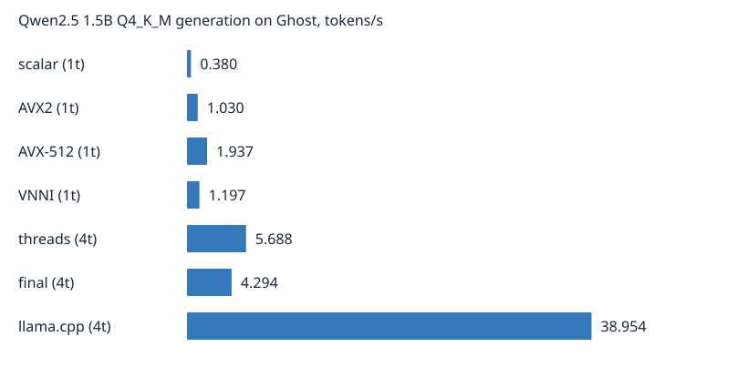

# Building Neuron: from a GGUF file to CPU chat

This write-up is for someone who wants to understand how Neuron is built and why the quality and speed numbers look the way they do.

Neuron is a C++20 inference engine for x86-64 Linux. The design keeps the
path from stored weights to generated tokens visible: a checked GGUF reader
(GGUF is the file format for the weights), a tokenizer, a transformer, a
KV cache (stored attention keys and values from earlier tokens) and a set
of CPU kernels. The terminal, web page and HTTP API all call that same
engine. There is no inference library underneath it.

The target is Qwen2.5 1.5B Instruct on an Intel Core i5-1135G7 laptop
(4 cores/8 threads, AVX-512 VNNI) with 16 GB RAM. The engine generates useful
chat replies. The final M5 Q4_K_M sample reached 11.02% of llama.cpp's
generation speed. R1 raises that to 55.02%: 21.215665 versus 38.558125
tokens/s, using four threads and the same short benchmark. The quality
agreement misses remain unchanged. [The machine and timing records](../../bench/SPEED.md#r1-result)
define both comparisons.

## Start with a reference

Before writing the forward pass, the baseline work pinned llama.cpp and
the model hashes. The harness saves prompt IDs, generated IDs, text,
timings, thread counts and observed power state. Compare mode reports the
first divergent token and exits unsuccessfully when exact agreement is
required. This makes a correctness claim repeatable without checking
weights into git.

TinyStories was the first implementation target because it is cheap to
run. Its tokenizer uses score-ordered merges and byte fallback. The
forward pass then implements embedding lookup, RMSNorm, rotary position
embeddings, causal attention, residual connections and SwiGLU. Greedy
decoding selects the largest logit and feeds that token back through the
model.

The M2 checks match all 51 tokenizer cases and all 128 generated IDs on
each baseline prompt. The largest final-position logit error is
9.54e-6, below the 1e-3 limit. Those results are in
[the numeric check](../../bench/reference/m2-checks.json) and
[the generation record](../../bench/M2_CHECKS.md). Tests on small synthetic
files exercise the implementation without requiring real models in CI.

## Map weights, own the mutable state

The GGUF reader maps the file read-only and validates metadata, dimensions,
block sizes, offsets, overlap and truncation before exposing tensor spans.
F32 weights can be read from that mapping directly. F16 weights are
converted to FP32 at load time. Packed quantized matrices stay mapped and
are decoded during products, avoiding a full expanded copy.

The model owns activations and per-layer keys and values. Each step appends
the new token's keys and values, then attends over the cached prefix.
Earlier layers and tokens are not recomputed during that reply. Cache and
full-recomputation checks agree for 32 generated tokens.
[The cache checks](../../bench/M3_CHECKS.md) cover synthetic Llama and Qwen2
models as well as TinyStories.

Qwen required grouped-query attention, QKV bias, split-half RoPE and a
rank-ordered byte BPE tokenizer with Unicode pre-tokenization. The chat
layer renders the text-only ChatML template in C++, with explicit system,
user and assistant roles. A built-in template also supplies the default
system text. It does not interpret arbitrary Jinja from a GGUF file.
All 63 Qwen tokenizer fixtures and four chat byte/token fixtures match
the pinned reference. [The M3 record](../../bench/M3_CHECKS.md) preserves
those fixtures and the memory check.

## Quantization changes quality as well as storage

The packed formats are Q8_0, Q4_0, Q4_K and Q6_K. Embedding lookup decodes
a row; matrix products decode blocks as they are consumed. Q4_K_M is a
model-level mixture of Q4_K and Q6_K matrices. It cannot be treated as a
file containing only one block format. Activations and the KV cache stay
FP32, and dot products use double accumulators.

Unit tests compare independent block decoding and check quantization error
bounds, including scale rounding. The larger M4 quality method scores
4,096 targets from a fixed WikiText-2 slice and generates 64 tokens on each
of twelve neutral prompts. [The committed method](../../bench/m4-method-v2.md)
was fixed before collection. Its [results](../../bench/reference/m4-v2-quantization.json)
give these perplexities (how well the model predicts the next token on a fixed text; lower is better) on identical files and input IDs:

| GGUF | Neuron | llama.cpp |
| --- | ---: | ---: |
| F16 | 11.580966 | 11.580968 |
| Q8_0 | 11.584336 | 11.614251 |
| Q4_0 | 13.129919 | 13.143771 |
| Q4_K_M | 12.145460 | 12.254528 |

Perplexity tracks llama.cpp within 0.9% for every tested format. The
free-running agreement gates were still missed. Q8_0 matched 551/768 IDs,
or 71.74%, against a 90% target. Q4_K_M matched 180/768, or 23.44%, against
a 70% target. Once a greedy continuation diverges, later positions compare
two different histories. Teacher-forced agreement diagnoses that effect,
but does not satisfy the free-running criterion. M4 was accepted with the
misses recorded in [the quality notes](../../bench/QUANT.md).

Smaller weights also did not automatically make the original scalar
implementation faster. Scalar Q4_K_M generated at 0.379621 tokens/s,
compared with 0.670816 for F16 in that sweep.
[The same M4 record](../../bench/reference/m4-v2-quantization.json) contains
both rates. The next work therefore focused on the kernels.

## Optimize one measured step at a time

Each M5 and R1 optimization has its own source commit and a short saved timing
sample. This chart is generated by `bench/speed.py` from the committed
records, with the original scalar point and the external reference kept
on the same scale.



| Step | Threads | Generation tokens/s |
| --- | ---: | ---: |
| Scalar | 1 | 0.379682 |
| AVX2 | 1 | 1.030390 |
| AVX-512 | 1 | 1.936931 |
| VNNI | 1 | 1.196552 |
| AVX-512 with threads | 4 | 5.687839 |
| Final recheck | 4 | 4.294374 |
| llama.cpp | 4 | 38.953875 |
| R1 final | 4 | 21.215665 |
| R1 llama.cpp | 4 | 38.558125 |

[The M5 source map and raw measurements](../../bench/SPEED.md#optimization-steps)
trace every point. All samples use `Once upon a time`, context 256 and
32 generated tokens, without a warmup. Generation excludes the first
sampled token because it comes from prompt evaluation.

AVX2 and AVX-512 kernels decode packed blocks directly and multiply them
by FP32 activations. Function target attributes keep those instructions
inside the kernels. Runtime CPU and OS checks guard dispatch, so the
baseline executable does not require AVX-512 just to start. R1 keeps the
direct SIMD path for nonfinite activations and a scalar reference.

The original M5 VNNI implementation packs activations into unsigned byte planes,
performs integer dot products and removes the packing bias before scaling.
That preserves enough precision to pass the scalar checks, but the
packing and extra operations cost time. VNNI was slower than AVX-512 here,
so automatic selection prefers AVX-512, then AVX2, then scalar. The result
describes that implementation. R1 replaces the K-block hot path with two
signed word planes retaining 31 activation bits. Group scales enter the
integer weights, word dots reconstruct in FP64 and Q4_K minimum offsets
use the original activation sums. The AVX-512 path checks for VNNI and
uses word dot instructions when supported. AVX2 and plain AVX-512 use
word multiply-add instructions. The error bound and tests are in
[the R1 profile](../../bench/R1_PROFILE.md).

The persistent thread pool partitions output rows. Workers share the
input and mapped weights, write disjoint outputs and retain each row's
accumulation order. The caller participates too. Changing the thread count
therefore does not change the order within a dot product. The thread test
passed 93,600 bit-identical comparisons; SIMD comparisons and short
perplexity guards are recorded in [the correctness checks](../../bench/SPEED.md#model-free-checks-and-ci).

The threaded point and final recheck use the same arithmetic kernels.
The later sample was slower. Frequency, temperature and scheduling were
not held fixed, and each point is a single short observation. The final
comparison uses 4.294374 tokens/s versus llama.cpp's 38.953875 with the
same file and four threads: 11.02%, below the 50% target. The miss was
accepted without another tuning cycle. [M7's wider model table](../../README.md#speed-vs-llamacpp)
added the missing short pairs. The current README uses the R1 Q4_K_M pair.

R1 generation is 3.69 times the fresh unmodified-main sample of 5.747949
tokens/s. Besides the K kernels, R1 reuses activation, logit and pool job
storage, computes RoPE angles once per position and briefly spins before
sleeping between pool jobs. It reaches 21.215665 tokens/s versus 38.558125
for llama.cpp, or 55.02%. These are short samples with unfixed frequency
and temperature. [Raw timings](../../bench/SPEED.md#r1-result) retain the
slower intermediate samples too.

## Put chat around the same forward pass

`ModelChat` renders the complete history, tokenizes it and validates the
prompt plus output budget before generation starts. It shares streaming
generation between the terminal and the POSIX HTTP server. UTF-8 output is
buffered across token boundaries, and cancellation is checked between
tokens. The terminal keeps history, handles reset and survives an
interrupted reply.

The server serializes requests, serves an embedded page without a frontend
build and returns either JSON or SSE for chat completions. The official
OpenAI Python client works with its usual methods and a local base URL.
[The M6 record](../../bench/M6_CHECKS.md) covers both real-model checks and
model-free error, framing and streaming tests. It also states the M6 API
subset: text messages, greedy decoding and a single request at a time.
Seeded sampling (temperature, top-k, top-p, min-p and a repeat penalty) and
stop strings came later, in the terminal, the server and `neuron run`; the
[command-line reference](../cli.md) lists every flag and API field. There
is still no authentication, TLS or tool execution, and the server handles
one request at a time.

The KV cache is reused within a reply. A new chat turn currently rebuilds
its full prompt, including history. Prompt processing is sequential and
uses matrix-vector operations, which helps explain why its behavior differs
from an engine that batches prompt tokens. This is a design limitation,
not a measured breakdown of the remaining performance gap.

## Reproduce the record

The [README](../../README.md#quick-start) builds and runs the engine from a
clean clone. The [M7 check sheet](../../bench/M7_CHECKS.md) gives exact speed
commands, source records and toolchain results. The [demo notes](../demo.md)
explain the real terminal capture. The [docs hub](../README.md) links the
milestone methods, including failed gates, so later work can compare
against the same inputs.

Regenerate the chart without loading a model:

```sh
python3 bench/speed.py chart \
  bench/reference/m5-speed-scalar.json bench/reference/m5-speed-avx2.json \
  bench/reference/m5-speed-avx512.json bench/reference/m5-speed-vnni.json \
  bench/reference/m5-speed-threads.json bench/reference/m5-speed-final.json \
  bench/reference/m5-speed-llama.json --output docs/assets/m5-speed.svg
```
