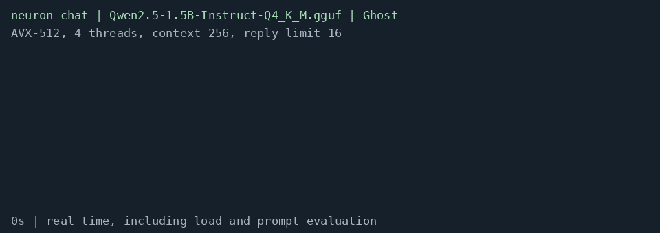

# Terminal chat capture



This is a recording of the actual `neuron chat` process with the standard
Qwen2.5 1.5B Instruct Q4_K_M file on Ghost. It shows a conversation, recall
of the earlier name, `/reset` and `/exit`. A PTY supplies the typed input
and captures the terminal's own echo and streamed output. The JSON retains
every output event with a monotonic timestamp, the exact command, model
and binary hashes, source hash, observed power/load and full transcript.

The GIF plays at real time. Model load and prompt processing waits are
included. Input is sent after each real prompt appears. No model text is
substituted or edited, and no pauses are removed. Rendering samples the
terminal text at fixed intervals and adds a title, execution settings and
elapsed clock. It is a text rendering of a terminal recording, not a screen
capture of a terminal application.

[The Qwen capture](../bench/reference/m7-demo.json) is the source. The
[SmolLM2 smoke check](../bench/reference/m7-smollm-chat.json) ran first.
[The M7 check sheet](../bench/M7_CHECKS.md) records file sizes and visual QA.

From the repo root, with models kept outside the tree:

```sh
python3 bench/record_chat.py record --binary build/neuron \
  --model "$NEURON_MODELS_DIR/Qwen2.5-1.5B-Instruct-Q4_K_M.gguf" \
  --output bench/runs/demo.json --notes 'Record actual machine activity.'
python3 bench/record_chat.py render --input bench/reference/m7-demo.json \
  --output docs/chat.gif
```

Capture uses only Python's standard library. Render requires Pillow and
DejaVu Sans Mono at the font path saved in the JSON. On Ubuntu these are
provided by `python3-pil` and `fonts-dejavu-core`. Render the committed JSON
to reproduce the same conversation; render `bench/runs/demo.json` to show
a new capture. The script refuses a GIF above the repository size limit.
